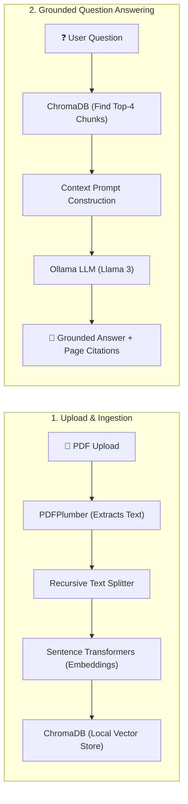

# PDF_Parser — AI-Powered PDF Question Answering System (RAG)

An ultra-simple, modern, AI-powered Retrieval-Augmented Generation (RAG) web application that enables users to upload PDF documents, extract text with PDFPlumber, split text into chunks, generate embeddings via Hugging Face Sentence Transformers, store chunks in ChromaDB, and ask natural-language questions grounded strictly in document context using a local Ollama LLM.

---

## 🌟 Ultra-Simple Project Architecture

The entire codebase has been consolidated into **just 2 main files** (one for backend, one for frontend), making it effortless to understand, run, and modify:

```text
pdf_parser/
├── backend/
│   ├── main.py            # Complete backend in ONE clean file (FastAPI + PDFPlumber + ChromaDB + Ollama)
│   ├── test_app.py        # Automated test suite in ONE file
│   ├── requirements.txt   # Backend dependencies
│   └── .env               # Configuration (Ollama URL, model name)
│
├── frontend/
│   ├── src/
│   │   ├── App.jsx        # Complete interactive UI in ONE file (Upload + Pipeline Status + Chat + Citations)
│   │   ├── main.jsx       # Mounts App
│   │   └── styles.css     # Clean responsive styling
│   ├── index.html
│   ├── vite.config.js
│   └── package.json
│
├── .gitignore
└── README.md
```

---

## 🔄 How the 2 Core Workflows Work



---

## 🚀 How to Run

### 1. Ensure Ollama is Running
In PowerShell:
```powershell
ollama serve
```
Make sure you have pulled a local model:
```powershell
ollama pull llama3:latest
```

### 2. Start the Backend
In a new PowerShell terminal:
```powershell
cd C:\Users\ACER\Desktop\pdf_parser\backend
.\.venv\Scripts\Activate.ps1
uvicorn main:app --host 127.0.0.1 --port 8000 --reload
```
- API Base URL: `http://127.0.0.1:8000`
- Interactive Swagger Docs: `http://127.0.0.1:8000/docs`

### 3. Start the Frontend
In another PowerShell terminal:
```powershell
cd C:\Users\ACER\Desktop\pdf_parser\frontend
npm run dev
```
- Open in browser: `http://localhost:5173`

---

## 🧪 Testing

Run the automated test suite (offline with mocked embeddings):
```powershell
cd C:\Users\ACER\Desktop\pdf_parser\backend
.\.venv\Scripts\Activate.ps1
pytest test_app.py -v
```
All tests pass in ~2 seconds.
