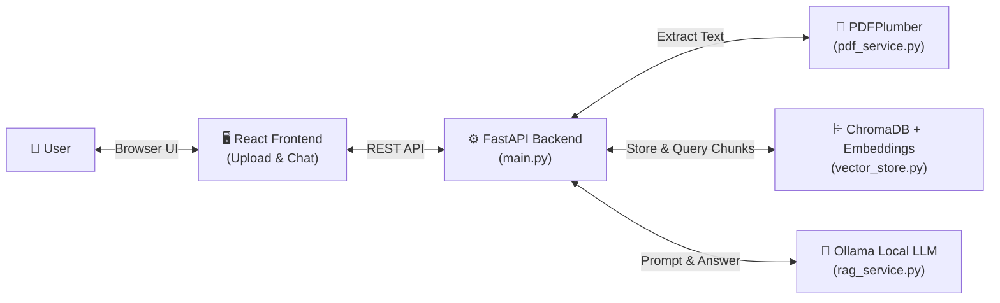

# PDF_Parser — AI-Powered PDF Question Answering System (RAG)

An AI-powered, retrieval-augmented generation (RAG) web application that enables users to upload PDF documents, extract text per page with PDFPlumber, split text into semantically preserved chunks, generate vector embeddings using Hugging Face Sentence Transformers, store and index chunks in ChromaDB, and ask natural-language questions grounded strictly in document context using a local Ollama LLM.

---

## 🏗️ Simplified Architecture Overview



### The 2 Core Workflows:
1. **Upload & Ingestion:**
   `PDF Upload` ➔ `PDFPlumber extracts pages` ➔ `Recursive character chunking` ➔ `Sentence Transformers vectorization` ➔ `Indexed in ChromaDB`.
2. **Grounded Question Answering:**
   `Question` ➔ `Similarity Search in ChromaDB (filtered by document_id)` ➔ `Retrieved context + prompt` ➔ `Ollama LLM (Llama 3)` ➔ `Grounded answer with page citations`.

---

## 📁 Simple Project Structure

```text
pdf_parser/
├── frontend/                     # React web application
│   ├── src/
│   │   ├── components/
│   │   │   ├── FileUpload.jsx    # Drag-and-drop PDF upload
│   │   │   ├── DocumentStatus.jsx# 6-stage pipeline progress tracker
│   │   │   ├── ChatWindow.jsx    # Conversational QA interface
│   │   │   ├── ChatMessage.jsx   # Formatted response with copy button
│   │   │   └── SourceReferences.jsx # Retrieved chunk viewer with page badges
│   │   ├── App.jsx               # Main screen layout and document library
│   │   ├── api.js                # Clean API service layer
│   │   ├── main.jsx              # Application entry point
│   │   └── styles.css            # Modern responsive stylesheet
│   ├── index.html
│   ├── vite.config.js
│   └── package.json
│
├── backend/                      # Python FastAPI backend
│   ├── app/
│   │   ├── pdf_service.py        # PDF extraction & scanned PDF validation
│   │   ├── vector_store.py       # ChromaDB vector storage & HuggingFace embeddings
│   │   ├── rag_service.py        # LangChain & Ollama RAG coordination
│   │   └── main.py               # REST API endpoints & schemas
│   ├── tests/                    # Automated pytest suite (19 unit/integration tests)
│   ├── requirements.txt
│   └── .env                      # Configurable settings
│
├── .gitignore
└── README.md
```

---

## 🚀 Quick Start Guide

### Step 1: Ensure Ollama is Running
In PowerShell:
```powershell
ollama serve
```
Make sure you have pulled a local model (e.g. Llama 3):
```powershell
ollama pull llama3:latest
```

### Step 2: Start the FastAPI Backend
Open a new PowerShell terminal:
```powershell
cd c:\Users\ACER\OneDrive\Documents\Desktop\pdf_parser\backend
.\.venv\Scripts\Activate.ps1
uvicorn app.main:app --host 127.0.0.1 --port 8000 --reload
```
- API Base URL: `http://127.0.0.1:8000`
- Interactive Swagger UI: `http://127.0.0.1:8000/docs`

### Step 3: Start the React Frontend
Open another PowerShell terminal:
```powershell
cd c:\Users\ACER\OneDrive\Documents\Desktop\pdf_parser\frontend
npm run dev
```
- Open browser at: `http://localhost:5173`

---

## 🧪 Running Tests

To run the full test suite (mocked embeddings & LLM, completely offline):
```powershell
cd c:\Users\ACER\OneDrive\Documents\Desktop\pdf_parser\backend
.\.venv\Scripts\Activate.ps1
pytest -v
```
All 19 tests will execute and pass in ~2 seconds.

---

## 📋 REST API Endpoints

- `GET /health` — Check backend health and Ollama model status.
- `POST /upload-pdf` — Upload PDF and trigger extraction, chunking, and ChromaDB vector indexing.
- `POST /ask` — Ask question and receive grounded answer with source page numbers.
- `GET /documents` — List all documents in the vector database.
- `DELETE /documents/{document_id}` — Delete a document and its ChromaDB vectors.
- `DELETE /chat/{session_id}` — Clear conversation history for a session.
